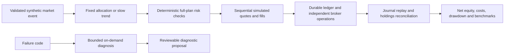

# Architecture and decisions

## Boundaries

Python 3.13, Decimal, SQLite and the official MCP Python SDK were chosen after
checking Public MCP coverage. The stable SDK 1.x line is version-locked and its
Streamable HTTP initialization, discovery and tool invocation are exercised over
mock HTTP. No MCP protocol or hosted broker server is rebuilt. A future SDK major
upgrade needs contract validation.

The application never treats an LLM response as an order. Routine pricing,
risk, accounting and reconciliation do not call a model. An optional
[bounded choice](AI_DECISIONS.md) can select one of the two fixed hypotheses for
the strategy account. Its durable receipt is checked before deterministic planning;
the comparison accounts preserve their rules. The small
optional diagnosis interface accepts only a stable failure code and returns an
allowed inspection action. It has no broker connection or policy mutation method.
There is no autonomous repair deployment or strategy-promotion path in this release.

## Paper strategy contract

One decision per UTC calendar month. Compare the latest EUR mark with the mean of
ten consecutive preceding calendar months' observations. An asset strictly above
its mean receives its configured weight; otherwise it receives zero. Unallocated
weight remains cash. The monthly fixture observations are synthetic and do not
provide total-return history or market calendars. A production data contract will
need the user's chosen cadence and completed-period conventions.

Passive retains the fixed 70/20 allocation, subject to the same reserve, order-size,
rebalance-band, cost and risk rules. Without-AI runs the same configured strategy
with the same routine operating charges and removes only inference costs. The
passive counterfactual assumes no application operating charges. Only one initial EUR 5,000 cash flow is supported;
additional deposits/withdrawals are rejected by the input contract. Valuation dates
are shared. Failed/interrupted workflows are explicitly marked noncomparable.

Every plan is checked before its first simulated order. Plans sell before buying,
floor quantities to six decimal places, round EUR postings half-up to cents, and
include fees and half the configured full bid/ask spread on each side. Cash above
the target is not forced into tiny orders. If market appreciation breaks the hard
cash floor, a minimum-size sale restores it. Drawdown beyond the configured limit
halts for review; it does not automatically liquidate. Drift can still exist between
monthly decisions and marks; the system does not provide continuous risk protection.

## Persistence and external outcomes

A paper event commits all state atomically. Locally, SQLite `BEGIN IMMEDIATE`
serializes writers. On AWS, a single small versioned S3 state object uses
`If-None-Match: *` for creation and ETag `If-Match` for updates. A losing writer or
unknown write result must replay the same event ID; the storage layer does not retry.
Same ID/different payload is rejected. A new ID in an already consumed month cannot
rebalance again. Out-of-order events cannot rewind the valuation.

State contains portfolio snapshots, a deposit/fill journal, simulated broker
operations, quotes, intents, daily volume, valuation history, cost reservations and
an audit history. Reconciliation replays the journal, compares broker cash/units,
compares operation identifiers and contents, and resolves only terminal fills tied
to known intents. A lost acknowledgement is recovered from broker operations.
An absent outcome remains unresolved. Partial fills do not trigger remainder orders.

Broker and ledger simulation share an atomic snapshot and have no external side
effects. This gives idempotent committed paper effects, **not exactly-once real
broker execution**. Real execution requires a separately reviewed durable outbox,
process ownership and account-specific broker-state matching before enabling writes.
The current S3 transition must never contain live network trades or model calls.

State is capped at 5 MB. It fails closed when archival/migration is needed; unlimited
history growth is not assumed. The design is for small, low-frequency paper runs,
not a shared high-throughput execution engine. Reconciliation is explicit and does
not rewrite historical event results or erase the halt audit.

## Accounting and research limits

Portfolio value includes unsold holdings at the last validated mark and all cash.
Fees enter cost basis or sale proceeds; spread is already reflected in fills and is
reported separately without subtracting it twice. Realized P&L uses proportional
average book cost; unrealized P&L is mark minus remaining book cost. Operations are
separate estimated/reserved expenses subtracted from net equity. They are not
claimed to be a reconciled cloud invoice. No FX, taxes, distributions, withholding
or fund expense estimates are silently invented; their absence is disclosed.

Maximum drawdown is measured at observation times, anchored at initial capital,
and can understate intramonth drawdown. Returns are simple initial-capital returns
because later cash flows are unsupported. No Sharpe ratio, fitted performance,
annualized short-sample return or profitability acceptance threshold is supplied.
Investment returns are not a software acceptance threshold.

Real strategy evaluation needs versioned total-return data, identical dates/cash
flows and cost assumptions, a preregistered experiment, untouched evaluation periods,
multiple-test accounting and a separate promotion decision. The initial system
ships two fixed hypotheses and no tuning loop, benchmark changes or promotions.

## Official Public MCP integration

Only `list_assets`, `list_available_currencies`, `get_ticker`,
`get_portfolio_holdings`, `get_portfolio_history` and `list_operation_history` are
allowed. Other discovered tools are discarded before exposure. Argument schemas
and any output schemas are checked; nonlocal schema references are blocked. Stable
metadata can be cached by a future verified adapter. Read calls are capped at ten
per session and network timeouts are bounded. Credentials are runtime headers,
never tool arguments or prompts; errors use fixed codes without upstream bodies.

Fixture contracts are explicitly synthetic protocol envelopes. A successful MCP
protocol check does not prove instrument eligibility or live domain mappings.
Read-only protocol access and ETF catalog identity have been checked. Portfolio
domain mapping and ticker responses still require independent contract validation.
No guessed REST response fields are used as a live adapter.
The new Public MCP is the only broker route; Fusion, Earn and crypto transfers are
outside scope. There is no duplicate REST execution implementation.

Sources: [official Public MCP catalog](https://docs.public.bitpanda.com/getting-started-589286f0),
[official Python SDK](https://github.com/modelcontextprotocol/python-sdk),
[S3 conditional writes](https://docs.aws.amazon.com/AmazonS3/latest/userguide/conditional-writes.html).
