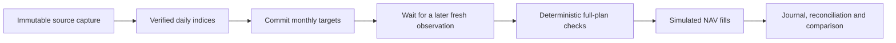

# Forward paper research

This runner commits target weights before a later NAV observation exists in its
input. It uses daily issuer/ECB **research index units**, with simulated fees and
fills. These quantities are not broker shares or executable ETF quotes.

The runner supports deterministic decisions and a bounded AI choice between the
same two fixed hypotheses. Paid calls are disabled by default. The examples need
no model, AWS deployment or broker account.

## Try the complete offline workflow

```sh
python3 -S examples/forward_demo.py
python3 -S examples/forward_demo.py --scripted-choice
```

It generates fictional source files, captures them through an injected fixture,
derives daily indices, waits for fresh input, commits a decision, rejects a
same-date execution observation and finally simulates a later NAV fill. Repeating
the command adds no orders, marks or operating charges. The report is saved to
`var/forward-demo/report.md`. No real investment-performance evidence is produced.
The second command uses fictional falling equity prices and a scripted response
to exercise a different choice for the strategy account. Its report goes to
`var/forward-choice-demo/report.md`. This is interface testing, not AI evidence.



## The causal boundary

The trial uses the latest completed signal month and ten preceding completed
months. Each month needs at least ten joint daily observations, with its final
observation within four days of month end. The existing passive and slow-trend
rules, weights and financial limits are retained.

At the runtime clock's decision time, the trial freezes its configuration,
observation/capture identities, signal date, hypothesis and per-account targets.
There is one decision per UTC calendar month. Its targets cannot be recomputed
using a later month, and a new input ID cannot open a second monthly decision.

Execution needs a newly received observation with a date strictly after the UTC
decision date. Its exact intraday NAV timestamp is unknown, so a NAV labelled with
the decision date is conservatively excluded even if received later. The selected
observation and capture must satisfy the existing 36-hour freshness limit.
Observation age is conservatively measured from the start of its UTC date;
morning collection can qualify where a late or weekend input cannot. No limit is
relaxed to make stale input work.

When a model is used, its bounded response must also be saved before execution.
The NAV date must be strictly later than **both** reservation and response dates,
and its receipt must follow the saved response. Input received while a call is
in progress cannot become a retrospective fill. The seven-day deadline still
starts at the original decision reservation.

The trial takes the first later observation that meets these gates. Both recording
and receipt must remain within seven days of the decision. An expired decision
stays in the audit, consumes its month, and never fills an old opportunity weeks
later. All comparators use the same modeled price date and starting cash.

## Inspect and advance a private trial

First prepare [a reviewed capture and daily artifact](ISSUER_IMPORT.md). Keep real
sources, configurations, trial states and results private. Then:

```sh
etf-autopilot --config var/trial/config.json --state var/trial/paper.sqlite3 \
  forward-cycle var/trial/daily-CAPTURE_ID.json

etf-autopilot --state var/trial/paper.sqlite3 forward-report
etf-autopilot --state var/trial/paper.sqlite3 forward-report --json
etf-autopilot --state var/trial/paper.sqlite3 forward-status
```

`decision_committed` places no order. Supply a subsequent verified daily artifact
to settle it. `waiting_for_future_observation` is expected; `waiting_for_input`
explains a missing/stale-input gate. No command fabricates a future value.
The default forward state is `var/forward-paper.sqlite3`, separate from the
original paper demo. Historical configs remain rejected by the ordinary engine.

`forward-status` is a read-only operating diagnosis using the current runtime
clock. It explains input age, remaining monthly reservations and the next operator
action. Unknown model outcomes, reconciliation and code review take priority over
ordinary stale-data waits. Inspecting status never expires a decision, clears a
halt, calls a provider or advances financial state. Add `--json` for structured
output; a successful diagnosis exits with code 0 even when it describes a wait.

The original default sizing policy still rejects oversized plans. An explicit
`execution.sizing_policy: bounded` can be evaluated in a separate config as
described in [operations](OPERATIONS.md#order-sizing-within-fixed-limits).
Changing configuration or financial code requires a reviewed new trial; it cannot
silently change an existing account or erase its prior results.

## One finite capture-to-report operation

Try its capture, decision commitment, report and replay with fictional files:

```sh
python3 -S examples/capture_demo.py --forward-tick
```

It commits a target without inventing a future fill. The report is saved at
`var/capture-demo/tick/report.md`, with zero network/model calls.

Once the source plan and config have been reviewed, the combined command performs
three bounded public downloads, verifies the daily artifact, runs one cycle and
retains the report:

```sh
etf-autopilot --config var/trial/config.json --state var/trial/paper.sqlite3 \
  forward-tick var/trial/capture-plan.json --out-dir var/trial/ticks/ATTEMPT_ID
```

`ATTEMPT_ID` is a stable identifier for this capture attempt, such as the intended
UTC collection date. Repeating the same directory verifies its evidence and state
without network reads, another model call, orders or charges. It returns that
attempt's immutable report, which can precede the current account state. Use a new
directory for the next intended observation. Do not rewrite a completed attempt.

The same explicit model options described below can be supplied. Configuration,
source plan, provider/cost options and code are bound before capture. A process
interrupted after committing a decision resumes under its existing monthly slot;
an unknown inference remains unknown. Failed or incomplete source downloads are
retained and require a new attempt directory; they are never silently retried.
Changed evidence, lost state and conflicting context fail closed.

The output contains `context.json`, a source `capture/`, `observations.json`,
`report.json`, `report.md` and the final hashed `tick.json` receipt. These are
private artifacts. `waiting_for_input` still saves evidence/report and exits with
code 2; operators must distinguish a stale-data wait from a successful decision.
No command installs a scheduler, changes AWS permissions or uploads these files.

## Integrity, costs and recovery

The trial retains a count and digest of its previously observed history. The next
capture must contain that exact prefix, normalization anchor and instrument/FX
policies. Revisions, backfills, changed identities and reversed clocks fail before
new orders or charges. New source-file hashes and capture times can change as
observations are appended; prior received values cannot.

All transitions commit atomically through the existing state store. Every reduced
plan passes risk checks before its first simulated order. Quotes and fills use
the real recording timestamp and retain a separate modeled NAV date. The daily
notional caps apply to that modeled research date. No network call occurs inside
the state transaction, and no external broker execution is claimed.

Routine operating cost is charged once when a decision is committed, not on replay.
Strategy and without-AI share it; passive assumes zero application charges. Only
the strategy account pays the inference reserve. Budgets are estimates, not a
cloud billing feed.

## Optional bounded model choice

The model receives anonymous equity/bond trend features from the completed signal
month and the two fixed candidate allocations. It can return only `passive` or
`slow_trend`. Assets, weights, risk limits and comparator behavior remain fixed.
Strict JSON rejects extra keys, duplicate keys and unknown strategies. The model
has no tools or broker access. Identical candidate allocations skip inference.

A call requires an explicitly reviewed model/region, positive cost reserve,
nonzero `operations.max_model_calls` and sufficient token/monthly budgets in a
separate private config. The ordinary defaults still permit zero model calls.
After that authorization, the opt-in command has this form:

```sh
etf-autopilot --config var/trial/config.json --state var/trial/paper.sqlite3 \
  forward-cycle var/trial/daily-CAPTURE_ID.json \
  --allow-model-call --model-id APPROVED_MODEL_ID --region APPROVED_REGION \
  --profile APPROVED_PROFILE --reserved-cost-eur APPROVED_RESERVE
```

The transaction consumes the monthly decision slot and saves its call/cost
reservation before creating the SDK client. One attempt runs outside the storage
transaction, with no SDK retry. Replay never invokes a reserved call again. A
timeout, invalid response or crash keeps its cost and month; there is no fallback
that silently turns the failed AI comparison into a successful deterministic one.
The report counts **reserved attempts**, including calls whose outcome is unknown.

An unknown reservation remains pending until explicitly inspected and closed:

```sh
etf-autopilot --state var/trial/paper.sqlite3 \
  forward-choice-abandon forward-decision:YYYY-MM
```

This closes the attempt without retrying, refunding or reopening its month.
The response cannot overwrite an operator's abandonment. Replaying an observation
with different provider/cost options is rejected; preserve its original options.
An incomplete comparison stays flagged even when later months proceed.

Unknown/partial/expired simulated outcomes halt further orders and preserve the
original decision and month. Explicitly inspect and reconcile confirmed operations:

```sh
etf-autopilot --state var/trial/paper.sqlite3 forward-reconcile
```

Reconciliation imports known fills, does not retry a remainder, and does not erase
the old halt audit. Unresolved evidence stays halted. Interrupted or expired trial
comparisons are flagged as incomplete even after portfolio reconciliation.

## Interpretation limits

Unsold positions remain marked after a halt. Daily sampled drawdown can differ
from the historical evaluator's monthly sampling and still misses intraday losses.
The drawdown gate runs before proposed execution; it does not liquidate holdings
or guarantee a maximum loss. Fund expenses/income treatment follow the source
index; cash yield is zero, investor taxes are excluded, and fee/spread assumptions
are modeled. Reference FX is not an execution quote.

Receipt time proves when this process received a file, not its original publication
time or publisher authenticity. Data integrity checks do not prove unseen history.
The runner measures a precommitted research workflow, not actual ETF tradability,
AI advantage or guaranteed returns. Source licensing, broker mappings, secure
runtime integration, alerts and an explicitly approved schedule remain separate.
