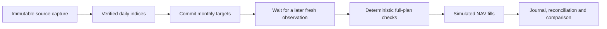

# Forward paper research

This runner commits target weights before a later NAV observation exists in its
input. It uses daily issuer/ECB **research index units**, with simulated fees and
fills. These quantities are not broker shares or executable ETF quotes.

The current runner is deterministic. The separate bounded AI choice interface
still operates on the original paper contract; forward model integration is the
next step. No model, AWS deployment or broker account is needed for this example.

## Try the complete offline workflow

```sh
python3 -S examples/forward_demo.py
```

It generates fictional source files, captures them through an injected fixture,
derives daily indices, waits for fresh input, commits a decision, rejects a
same-date execution observation and finally simulates a later NAV fill. Repeating
the command adds no orders, marks or operating charges. The report is saved to
`var/forward-demo/report.md`. No real investment-performance evidence is produced.



## The causal boundary

The trial uses the latest completed signal month and ten preceding completed
months. Each month needs at least ten joint daily observations, with its final
observation within four days of month end. The existing passive and slow-trend
rules, weights and financial limits are retained.

At the runtime clock's decision time, the trial freezes its configuration,
observation/capture identities, signal date, hypothesis and per-account targets.
There is one decision per UTC calendar month. Its targets cannot be recomputed
using a later month, and a new input ID cannot open a second monthly decision.

Execution needs a newly received observation with a date strictly after the UTC
decision date. Its exact intraday NAV timestamp is unknown, so a NAV labelled with
the decision date is conservatively excluded even if received later. The selected
observation and capture must satisfy the existing 36-hour freshness limit.
Observation age is conservatively measured from the start of its UTC date;
morning collection can qualify where a late or weekend input cannot. No limit is
relaxed to make stale input work.

The trial takes the first later observation that meets these gates. Both recording
and receipt must remain within seven days of the decision. An expired decision
stays in the audit, consumes its month, and never fills an old opportunity weeks
later. All comparators use the same modeled price date and starting cash.

## Inspect and advance a private trial

First prepare [a reviewed capture and daily artifact](ISSUER_IMPORT.md). Keep real
sources, configurations, trial states and results private. Then:

```sh
etf-autopilot --config var/trial/config.json --state var/trial/paper.sqlite3 \
  forward-cycle var/trial/daily-CAPTURE_ID.json

etf-autopilot --state var/trial/paper.sqlite3 forward-report
etf-autopilot --state var/trial/paper.sqlite3 forward-report --json
```

`decision_committed` places no order. Supply a subsequent verified daily artifact
to settle it. `waiting_for_future_observation` is expected; `waiting_for_input`
explains a missing/stale-input gate. No command fabricates a future value.
The default forward state is `var/forward-paper.sqlite3`, separate from the
original paper demo. Historical configs remain rejected by the ordinary engine.

The original default sizing policy still rejects oversized plans. An explicit
`execution.sizing_policy: bounded` can be evaluated in a separate config as
described in [operations](OPERATIONS.md#order-sizing-within-fixed-limits).
Changing configuration or financial code requires a reviewed new trial; it cannot
silently change an existing account or erase its prior results.

## Integrity, costs and recovery

The trial retains a count and digest of its previously observed history. The next
capture must contain that exact prefix, normalization anchor and instrument/FX
policies. Revisions, backfills, changed identities and reversed clocks fail before
new orders or charges. New source-file hashes and capture times can change as
observations are appended; prior received values cannot.

All transitions commit atomically through the existing state store. Every reduced
plan passes risk checks before its first simulated order. Quotes and fills use
the real recording timestamp and retain a separate modeled NAV date. The daily
notional caps apply to that modeled research date. No network call occurs inside
the state transaction, and no external broker execution is claimed.

Routine operating cost is charged once when a decision is committed, not on replay.
Strategy and without-AI share it; passive assumes zero application charges. Model
calls remain zero in this runner. Budgets are estimates, not a cloud billing feed.

Unknown/partial/expired simulated outcomes halt further orders and preserve the
original decision and month. Explicitly inspect and reconcile confirmed operations:

```sh
etf-autopilot --state var/trial/paper.sqlite3 forward-reconcile
```

Reconciliation imports known fills, does not retry a remainder, and does not erase
the old halt audit. Unresolved evidence stays halted. Interrupted or expired trial
comparisons are flagged as incomplete even after portfolio reconciliation.

## Interpretation limits

Unsold positions remain marked after a halt. Daily sampled drawdown can differ
from the historical evaluator's monthly sampling and still misses intraday losses.
The drawdown gate runs before proposed execution; it does not liquidate holdings
or guarantee a maximum loss. Fund expenses/income treatment follow the source
index; cash yield is zero, investor taxes are excluded, and fee/spread assumptions
are modeled. Reference FX is not an execution quote.

Receipt time proves when this process received a file, not its original publication
time or publisher authenticity. Data integrity checks do not prove unseen history.
The runner measures a precommitted research workflow, not actual ETF tradability,
AI advantage or guaranteed returns. Source licensing, broker mappings, secure
runtime integration, alerts and an explicitly approved schedule remain separate.
